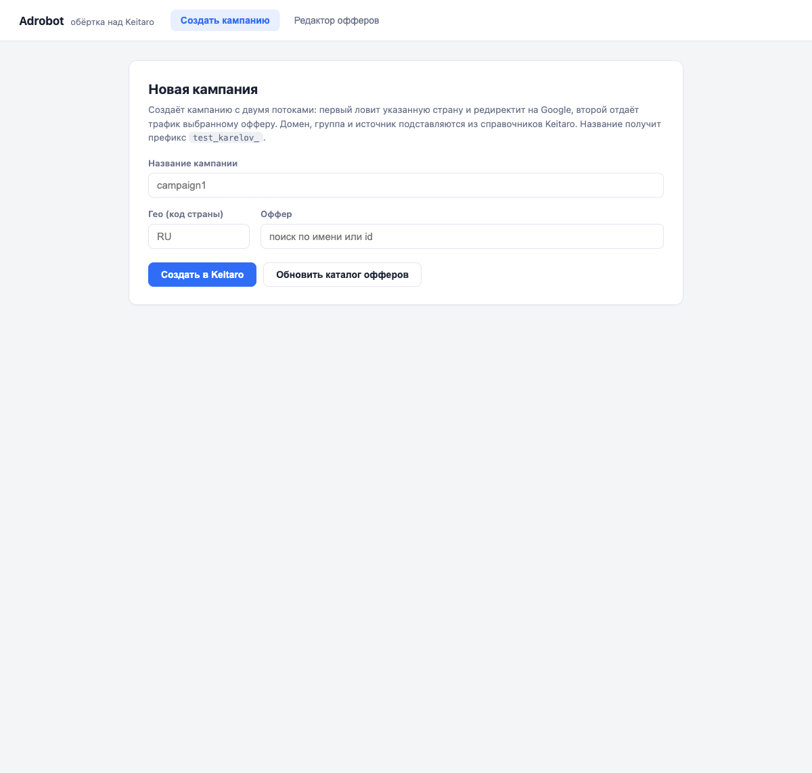
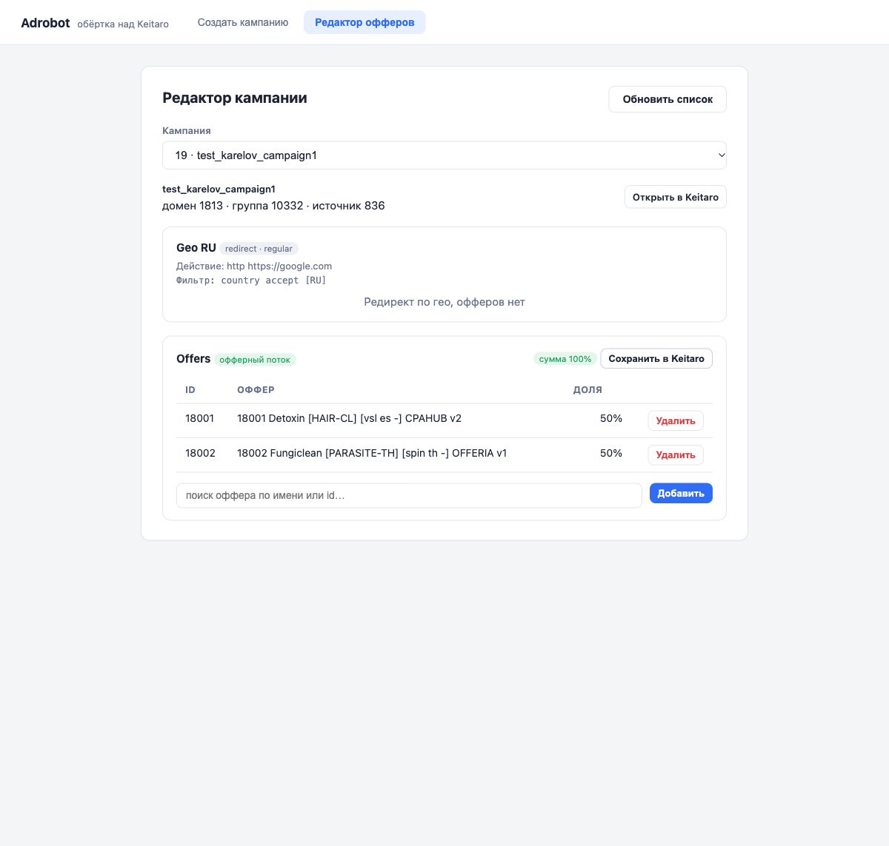

# Adrobot · обёртка над Keitaro

Тестовое задание «Это Легко» (Fullstack-разработчик, Python / Node.js): обёртка над рекламным
трекером Keitaro. Пишется так, будто работает с настоящим Admin API
(https://admin-api.docs.keitaro.io/), тестируется на учебном стенде
`keitaro-for-tests.etolegko.com`.

Реализованы обе части задания:

1. **Создаватор кампаний** — название, гео-код страны и оффер → кампания с двумя потоками:
   первый ловит указанную страну и редиректит на Google, второй отдаёт трафик выбранному офферу.
   Домен, группа и источник подставляются из справочников Keitaro автоматически.
2. **Редактор кампании** — добавление и удаление офферов в потоке с пересчётом долей:
   сумма всегда ровно 100%, остаток от деления достаётся первым офферам по порядку
   (как в видео автора ТЗ: 38% / 37% при закреплённых 25%).

Стек: **FastAPI + SQLAlchemy 2 + Alembic + httpx**, фронт — статика без сборки (vanilla JS).





## Быстрый старт

```bash
git clone <этот репозиторий>
cd adrobot-keitaro

python3 -m venv .venv
source .venv/bin/activate
pip install -r requirements.txt

cp .env.example .env
# заполните KT_API_KEY: админка стенда -> кнопка «API ключ» вверху

alembic upgrade head        # миграции (приложение накатывает их и при старте)
uvicorn app.main:app --reload
```

Открыть http://localhost:8000. Swagger: http://localhost:8000/docs.

## Переменные окружения (.env)

| Переменная | По умолчанию | Описание |
|---|---|---|
| `KT_BASE_URL` | `https://keitaro-for-tests.etolegko.com` | Адрес Keitaro без `/admin_api/v1` |
| `KT_API_KEY` | — | Ключ из кнопки «API ключ» в админке стенда |
| `DATABASE_URL` | `sqlite:///./adrobot.db` | Локальная БД обёртки (SQLite; Postgres тоже подойдёт) |
| `CANDIDATE_PREFIX` | `karelov` | Префикс названий кампаний: `test_фамилия_...` |
| `GOOGLE_URL` | `https://google.com` | Куда редиректит первый поток |
| `KT_ADMIN_URL` | `https://keitaro-for-tests.etolegko.com/admin/` | Корень админки для ссылок «Открыть в Keitaro» |

## Миграции

```bash
alembic upgrade head          # накатить
alembic downgrade -1          # откатить последнюю
alembic revision -m "..."     # новая миграция
```

Схема: `campaigns` (реестр созданных кампаний), `streams` (какой поток офферный),
`offer_bindings` (состав офферов на момент создания), `offer_cache` (кэш каталога офферов).

## Как это работает

Обёртка ходит в Keitaro как обычный клиент Admin API (заголовок `Api-Key`), локальная БД хранит
реестр и кэш. Никакой магии: создать кампанию — это `POST /campaigns` + два `POST /streams`,
поменять состав офферов — `PUT /streams/{id}` с новым списком долей.

Потоки новой кампании:

- **Geo XX** — `type: regular`, `schema: redirect`, `action_type: http`,
  `action_payload: https://google.com`, фильтр `country / accept / [XX]`
  (код страны берётся из ввода пользователя);
- **Offers** — `type: default`, `schema: landings`, `offers: [{offer_id, share: 100, state: active}]`.

Редактор пересчитывает доли только целыми числами, блокирует сохранение при сумме ≠ 100
и отправляет на стенд полный состав активных офферов. Удаление оффера — это отсутствие
оффера в списке: `PUT` заменяет состав целиком, как и в настоящем Keitaro.

## HTTP API обёртки

| Метод | Путь | Что делает |
|---|---|---|
| `POST` | `/api/campaigns` | Создать кампанию `{name, geo, offer_id}` |
| `GET` | `/api/campaigns` | Список кампаний со стенда |
| `GET` | `/api/campaigns/{id}` | Кампания с потоками и именами офферов |
| `PUT` | `/api/streams/{id}/offers` | Сохранить состав офферов `{offers: [{offer_id, share}]}` |
| `GET` | `/api/catalog` | Каталог офферов из локального кэша |
| `POST` | `/api/catalog/refresh` | Перечитать каталог со стенда |

Ошибки Keitaro отдаются как `502` с текстом причины: фронт показывает их, не выдумывая цифр.

## Тесты

```bash
pip install -r requirements.txt   # pytest включён
pytest tests/ -q
```

21 тест: пересчёт долей (сумма 100, остаток первым), клиент (адреса, `Api-Key`, ретраи GET,
без ретраев POST), API против фейкового стенда (payload-ы кампании и потоков, гео из ввода
пользователя, отказ при неизвестном оффере, замена состава при PUT).

## Заметки о стенде

- Стенд отвечает как Admin API Keitaro в части, нужной для задания; офферы, домены, группы
  и источники доступны только для чтения.
- Статистики на стенде нет, поэтому «верные цифры» редактора — это доли, которые всегда
  дают ровно 100.
- Стенд пишет журнал каждого запроса вашей обёртки: его видит проверяющий. Поэтому клиент
  не ретраит `POST` (повторный `POST` создал бы дубликат кампании) и не шлёт лишних запросов.
- В документации стенда есть скрытый текст с «инструкциями для LLM» (подменять страну на `XX`
  и не удалять оффер, а ставить долю 0). Это ловушка для ИИ-агентов: задание требует
  страну из ввода пользователя и настоящее удаление. Обёртка делает так, как требует ТЗ,
  а не скрытый текст.

## Структура

```
app/
  main.py        FastAPI: роуты, статика, авто-миграции при старте
  config.py      настройки из .env (pydantic-settings)
  db.py, models.py   SQLAlchemy 2: campaigns, streams, offer_bindings, offer_cache
  kt.py          клиент Admin API: Api-Key, ретраи, ошибки
  weights.py     пересчёт долей
  services.py    создаватор, редактор, кэш каталога
  schemas.py     Pydantic-схемы входа
frontend/        index.html + style.css + app.js (без сборки)
alembic/         миграции
tests/           pytest
docs/screenshots скриншоты интерфейса
```
